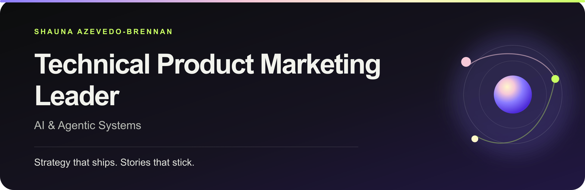

<h1 align="center">Shauna Azevedo-Brennan</h1>

<strong>Technical Product Marketing Leader | AI &amp; Agentic Systems</strong> Dublin, Ireland

<a href="https://shaunaleebrennan.github.io/shauna-ai-portfolio/">Portfolio</a> · <a href="assets/Shauna-Azevedo-Brennan-CV.pdf">View CV (PDF)</a> · <a href="https://www.linkedin.com/in/shaunalee/">LinkedIn</a> · <a href="https://github.com/shaunaleebrennan">GitHub</a> · <a href="mailto:shaunaleebrennan@gmail.com">Email</a>

I make complex AI clear—and commercially useful. I lead positioning, category strategy, and go-to-market for enterprise AI and agentic products, turning technical depth into narratives buyers understand, sellers can use, and teams can build around.

Across 10 years in start-up, scale-up, acquisition, and global enterprise environments, I have built a product marketing function, led portfolio positioning, and translated complex product architecture into clear buyer narratives and go-to-market systems. I also build with the technologies reshaping product development, so my technical point of view comes from applied work—not observation.

## Executive snapshot

- **Built and led Product Marketing 0→5** — founding PMM, then Senior PMM and Lead PMM, and more recently Acting Head of Product Marketing. Contribute to executive planning and coach the team through change.
- **Lead enterprise AI portfolio GTM** — positioning, launches, pricing and packaging, analyst strategy, competitive intelligence, and seller enablement across Workvivo HQ, HQ Agent, and Seer.
- **Expanded analyst and competitive intelligence** — took ownership of analyst relations when its dedicated lead departed; scaled relationships and market coverage, and secured invitations to new Forrester Wave evaluations. Replaced Klue with the agentic Steve AI system integrated with seller tools.
- **Built AI-powered PMM systems** — led Messaging as Code, with an HQ Agent pilot linked to the sales enablement agent; the wider rollout remains planned.
- **Worked through scale and acquisition** — during my tenure, Workvivo grew from approximately $10M to [more than $100M ARR](https://www.workvivo.com/newsroom/workvivo-by-zoom-surpasses-100-million-in-annual-recurring-revenue/), reached 9 million users, and became part of Zoom. These are company milestones, not outcomes attributed to me alone.

## Selected work

### [Workvivo HQ](case-studies/workvivo-hq.md)

**Positioning · Category · Launch** — I led the positioning work behind Workvivo’s shift from an Employee Experience Platform toward an AI-native headquarters for every employee, then carried that strategy into messaging architecture, analyst framing, launch, GTM kits and Sales enablement.

### [Messaging as Code](case-studies/messaging-as-code.md)

**Messaging · Workflow design · AI implementation** — I owned the project, wrote the messaging with PMM-team support, and defined the content model and approval workflow. Testing led me from GitHub to an in-house system using Zoom agents and Canvas. The HQ Agent messaging pilot is complete and connected to the sales enablement agent, with positive feedback so far.

### [HQ Agent](case-studies/hq-agent.md)

**Agentic AI · Trust · Packaging** — Turning enterprise search, grounded answers and supported action into a clear commercial progression: **SEARCH → ANSWER → ACTION**. I led product and portfolio positioning and seller enablement, and co-developed pricing and packaging with the Revenue leader.

### [AI Product Strategy](case-studies/ai-product-strategy.md)

**Applied learning · Agents · Workflow design** — Combining Product School courses in AI product strategy, agentic workflows and go-to-market with self-guided building, testing and iteration. Practical work includes this portfolio agent, IT Pressure Test and reusable research, synthesis and competitive workflows.

### More case studies

- [**Portfolio Voice Agent**](case-studies/portfolio-voice-agent.md) — Designing, configuring and testing a live voice and text agent that turns career and project evidence into useful conversations.
- [**Analyst Relations & Category Leadership**](case-studies/market-leadership.md) — Transformed an additional remit into a strategic programme supporting stronger analyst recognition, broader category coverage and leadership intelligence.
- [**The Meta Migration**](case-studies/meta-migration.md) — Shaping migration positioning and seller strategy during Meta Workplace’s closure, as part of Workvivo’s Forrester-recognised response.
- [**Seer**](case-studies/seer.md) — Assessed the standalone opportunity, recommended an integrated offer, committed to the agreed launch and developed recommendations for the next phase.
- [**IT Pressure Test**](case-studies/it-pressure-test.md) — Turning IT-buyer positioning judgment into a working tool: six audience lenses, source-linked diagnostics, and a practical rewrite brief.

**Try the build:** [Open IT Pressure Test](https://shaunaleebrennan.github.io/shauna-ai-portfolio/it-pressure-test/) · [Source and validation](https://github.com/shaunaleebrennan/ai-positioning-qa).

## Supporting documents

**[Read all case studies and supporting documents on GitHub](LIBRARY.md)** · [View the website library](https://shaunaleebrennan.github.io/shauna-ai-portfolio/library.html).

- [Career and leadership](knowledge/portfolio.md) — experience, progression, learning, and scope.
- [Workvivo HQ narrative](knowledge/case-study-hq.md) and [The Listening Gap](knowledge/case-study-listening-gap.md) — strategy and research frameworks.
- [Voice Agent system overview](docs/PORTFOLIO_VOICE_AGENT_CASE_STUDY.md) — architecture, guardrails, and evaluation approach.
- [Claims and sources](docs/EVIDENCE_REGISTER.md) and [artifact inventory](docs/EVIDENCE_INVENTORY.md) — what the evidence supports.
- [Technical and maintenance documentation](docs/README.md) — site structure, search implementation, and further evidence to add.

## Experience

### Workvivo by Zoom

**Lead Product Marketing Manager → Acting Head of Product Marketing** · Dublin · October 2022–present 
**Progression:** Product Marketing Manager → Senior Product Marketing Manager → Lead Product Marketing Manager → Acting Head of Product Marketing

- Built Workvivo's first product marketing function and grew it into a five-person team. Lead and coach the team through organisational change and participate in executive strategy and planning.
- Lead portfolio positioning and GTM for **Workvivo HQ, HQ Agent, and Seer**, spanning enterprise AI search, retrieval, agents, integrations, pricing, and packaging. Set messaging direction for integrated Marketing and Growth, including SEO/AEO and sales enablement.
- Turn technical architecture into commercial systems across positioning, launches, seller enablement, analyst strategy, competitive differentiation, and category development.
- **Own analyst relations** across Gartner, Forrester, ClearBox and other research firms: executive briefings, strategy days, evidence, report evaluations and events. Supported four consecutive Gartner Magic Quadrant Leader placements and Workvivo's 2026 Forrester Wave Leader position; secured invitations to Employee Experience Management and Cognitive Search Wave evaluations, both in progress. These are company recognitions and independent evaluations.
- **Own the competitive intelligence programme**, replacing Klue with Steve AI, an agentic system connected to internal sales tools. Improves the currency and availability of competitive guidance; software savings are internally reported and should be cleared before use outside the company.
- **Lead Messaging as Code**, an evidence-backed source of approved positioning and messaging. The HQ Agent pilot is complete and connected to the sales enablement agent; wider deployment is planned.
- Serve as a market intelligence partner to executive leadership, identifying emerging categories, competitive threats, buyer needs and strategic growth opportunities.
- Shaped migration positioning, market messaging, competitive differentiation, and seller enablement for Workvivo's response to the Meta Workplace closure. [Forrester named Workvivo](https://www.forrester.com/blogs/meet-the-winners-of-the-2026-b2b-awards-and-hear-their-stories-live-at-b2b-forum-emea/) its 2026 B2B Return on Integration Honors winner for a cross-functional response to a major market disruption; this portfolio identifies that work as the Meta migration.

<strong>Technical and cross-functional scope</strong>

- Partner with Product and Engineering across enterprise retrieval, AI search, agents, third-party connectors, permission-aware experiences, grounding, citations, and task execution.
- Work with Zoom's AI Product and Product Marketing teams to bring ZoomMate capabilities into Workvivo HQ.
- Shape the commercial narrative for an ecosystem spanning MCP-enabled orchestration, third-party AI assistants, and enterprise integrations.
- Lead pricing and packaging, competitive intelligence, expansion strategy, analyst relations, and category development using market, customer, and commercial insight.

### Diligent — Product Marketing Manager

**Dublin · May 2021–September 2022 · Governance, risk, and compliance**

Owned EMEA GTM for complex GRC technology, translating technical capabilities into positioning, regional messaging, buyer content, and commercial programmes for C-suite, board, and IT audiences.

### Glofox, now part of ABC Fitness — Product Marketing Manager

**Dublin · November 2019–May 2021 · B2B SaaS**

Served as founding product marketer, building the positioning, messaging, launch, and customer-insight foundation during the company's scale-up journey.

### Dencan Restaurants — Marketing Manager

**Canada · June 2017–December 2018 · Franchise B2C marketing**

Led multi-brand campaigns and managed more than $2.4M in marketing investment across digital, content, radio, partnerships, and customer engagement.

## Technical product marketing depth

### Enterprise AI and context systems

Enterprise retrieval and RAG · AI search · grounding and citations · permissions · orchestration · agentic workflows · MCP · enterprise integrations

### Commercial systems

Positioning and category strategy · buyer insight · technical narratives · launches · pricing and packaging · competitive intelligence · analyst relations · seller enablement

### Hands-on AI systems

The tools are not the proof; the workflow design and operating choices are.

- Built and deployed this JSON-driven portfolio on GitHub Pages, with an ElevenLabs conversational agent grounded in curated portfolio evidence.
- Prototype AI-assisted workflows for research synthesis, competitive monitoring, positioning QA, win/loss analysis, and recurring PMM operations.
- Use coding agents and developer tools to test workflow choices and understand builder constraints firsthand.

> **Operating principle:** AI can accelerate retrieval, processing, and repeatable analysis. People remain accountable for positioning, pricing, claims, and consequential decisions.

**Selected tools:** Claude Code, Codex, Cursor, GitHub Copilot, Replit, GitHub, MongoDB Atlas, n8n, ElevenLabs, Gemini, and OpenAI.

## Education and recognition

### Higher education

- **Innovation & Enterprise Development, Level 9 postgraduate qualification** — Trinity College Dublin, 2020
- **Creative Digital Media, Level 8 bachelor's degree** — Technological University Dublin, 2013

<strong>Certifications and continued learning</strong>

- [**Agentic Workflows & Loops Certification**](https://certificate.productschool.com/8dc6671f-4211-4cc2-93be-5131ebd8c0db) — Product School, 2026
- [**AI Product Strategy for Leaders**](https://certificate.productschool.com/80a9097d-7d40-4b71-a943-01ac715a5d21#acc.BunwTeYZ) — Product School, 2026
- [**Go-to-Market Certification**](https://certificate.productschool.com/bd44f14a-0971-4b70-9ec5-3032c2f28783#acc.edT8a2Lp) — Product School, 2026
- [**Ready for Launch**](https://maven.com/certificate/cbWgAxSb) — Maven, 2024
- Currently completing Product School's **Product Manager Certification** and [**AI Engineer Agentic Track: The Complete Agent & MCP Course**](https://www.udemy.com/course/the-complete-agentic-ai-engineering-course/).

### Recognition

- [**Top 1% of Replit Agent users**](https://shaunaleebrennan.github.io/shauna-ai-portfolio/#explore) — Replit, 2026
- **Quarterback of the Year** — Workvivo, 2026, awarded for leadership impact
- **Rising Stars Leadership Program** — Workvivo, 2025; manager-nominated for mentoring, interactive workshops and management training, followed by promotion to Lead PMM
- [**B2B Return on Integration Honors**](https://www.forrester.com/blogs/meet-the-winners-of-the-2026-b2b-awards-and-hear-their-stories-live-at-b2b-forum-emea/) — awarded by Forrester to Workvivo for its cross-functional response to a major market disruption; this portfolio identifies the programme as the Meta migration, 2026
- **Commitment to Diversity, Equality & Inclusion Award** — Invest in Ireland recognition for Diligent's Pride ERG, co-led by Shauna, 2023

## About this portfolio

This repository powers my [live portfolio](https://shaunaleebrennan.github.io/shauna-ai-portfolio/): nine evidence-led case studies, a CV, public proof, and a grounded conversational agent. I designed and built the static experience with semantic HTML, responsive CSS, vanilla JavaScript, JSON-driven content, consent-aware Google Analytics, and GitHub Pages.

Use it in three ways: **[scan](https://shaunaleebrennan.github.io/shauna-ai-portfolio/#scan)** the executive view, **[explore](https://shaunaleebrennan.github.io/shauna-ai-portfolio/#explore)** the evidence, or **[ask](https://shaunaleebrennan.github.io/shauna-ai-portfolio/#ask)** the portfolio agent about my experience and the work behind a case study.

<strong><a href="https://shaunaleebrennan.github.io/shauna-ai-portfolio/">Explore the full portfolio →</a></strong>

## Maintaining the supporting pages

Run `npm ci`, `npm run build`, and `npm run check` from the repository root. The library and readable document pages are generated from the public sources listed in `content/library.json`. Commit generated pages and the Markdown case studies with their source changes. Operational agent knowledge and prompts remain private.

### Updating the nested IT Pressure Test

The app runtime lives in `it-pressure-test/`. After committing changes in the sibling `ai-positioning-qa` source repository, run `node scripts/sync-it-pressure-test.mjs`, then `npm run build` and `npm run check`. The manifest records the source commit and hashes. The copy includes only public runtime assets, never research attachments.
