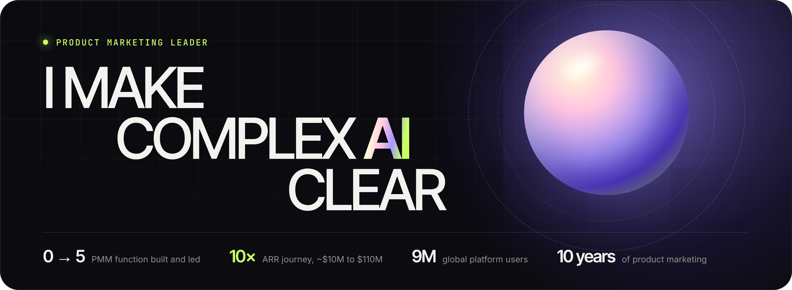
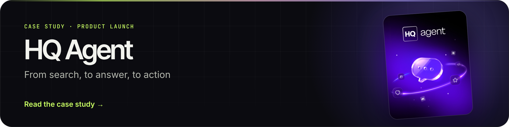
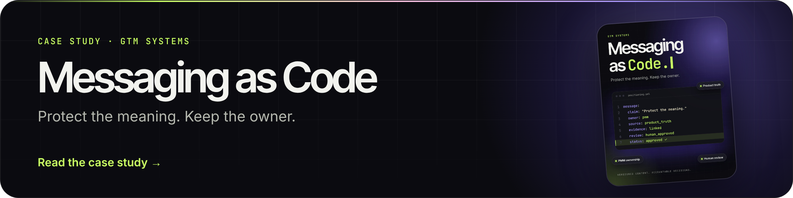
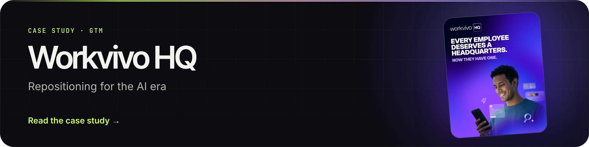
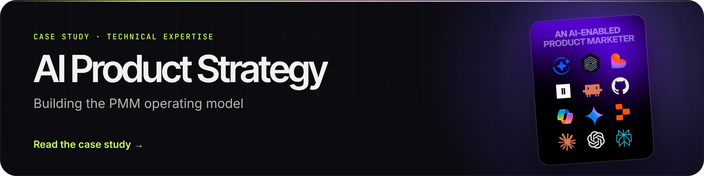
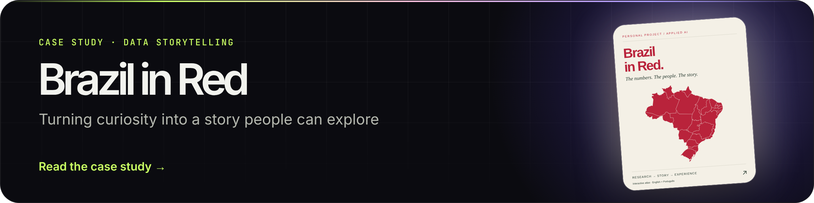

<h1 align="center">Shauna Azevedo-Brennan</h1>

<strong>Product Marketing Leader</strong> · Strategy, Intelligence &amp; AI Innovation Dublin, Ireland

<a href="https://shaunaleebrennan.github.io/shauna-ai-portfolio/">Portfolio</a> · <a href="assets/Shauna-Azevedo-Brennan-CV.pdf">CV (PDF)</a> · <a href="https://www.linkedin.com/in/shaunalee/">LinkedIn</a> · <a href="https://github.com/shaunaleebrennan">GitHub</a> · <a href="mailto:shaunaleebrennan@gmail.com">Email</a>

Product marketing leader with 10+ years in marketing across enterprise SaaS and AI. Joined Workvivo as its first PMM, built a five-person function and progressed to Acting Head of Product Marketing during the company’s growth beyond $110M ARR and acquisition by Zoom. Work with executive leadership on strategy and lead positioning, GTM, competitive intelligence and analyst relations. Build AI-powered systems that make market insight, messaging and seller enablement more useful.

## Selected work

**[HQ Agent](case-studies/hq-agent.md)** — Customer-led GTM for the next AI investment: positioning, pricing and packaging, and seller enablement.

**[Messaging as Code](case-studies/messaging-as-code.md)** — A governed source of approved messaging that people and AI agents can reuse, with PMM ownership and human review.

**[Workvivo HQ](case-studies/workvivo-hq.md)** — Repositioning an employee experience platform as an AI-powered digital HQ, from narrative to launch.

**[AI Product Strategy](case-studies/ai-product-strategy.md)** — Applied learning in AI product strategy, agents and workflow design, tested through hands-on builds.

**[Brazil in Red](case-studies/brazil-in-red.md)** — A bilingual, interactive election atlas built from a personal question. [Explore the live atlas](https://brasil-voto-atlas-2026.shaunaleebrennan.chatgpt.site/).

**More:** [Portfolio Voice Agent](case-studies/portfolio-voice-agent.md) · [The Meta Migration](case-studies/meta-migration.md) · [Analyst Relations &amp; Category Leadership](case-studies/market-leadership.md) · [All case studies and supporting documents](LIBRARY.md)

## Experience

### Workvivo by Zoom · Dublin
**Lead Product Marketing Manager → Acting Head of Product Marketing** · October 2022–present

- **Leadership & strategy:** Built and led PMM from its first hire to a team of five through 10×+ company ARR growth and Zoom’s acquisition. Contribute to executive planning and coach the team through significant organisational change.
- **Positioning & solutions marketing:** Lead positioning, messaging and GTM for Workvivo HQ, HQ Agent and Seer, evolving the story towards an AI-powered digital HQ without losing the employee experience differentiation.
- **IMM & sales enablement:** Set messaging direction for Marketing and Growth campaigns, connecting customer insight to pipeline priorities, SEO/AEO, launches, demos and sales conversations.
- **Analyst relations & market leadership:** Built and scaled Workvivo’s analyst relations program, supporting stronger placements across Gartner, Forrester and ClearBox and wider research coverage. Secured invitations to Forrester Wave evaluations in Employee Experience Management and Cognitive Search, both in progress.
- **Category strategy & market intelligence:** Advise executive leadership on market shifts, competitive threats and emerging opportunities, helping shape product strategy, category positioning and growth priorities.
- **Competitive intelligence program:** Replaced Klue with Steve AI, an agentic intelligence system connected to seller tools. Reduced annual software costs by more than 60k while keeping competitive guidance current and accessible.
- **AI-powered PMM systems:** Designed a messaging-as-code system to make approved messaging and its evidence reusable. Completed an HQ Agent pilot connected to our sales enablement agent; also build and test AI agents and workflows firsthand.
- **Major GTM initiative:** Led migration positioning, competitive differentiation and seller enablement for Workplace from Meta, contributing to Workvivo’s Forrester-recognised company-wide response.

### Diligent · Dublin
**Product Marketing Manager** · May 2021–September 2022

- **EMEA GTM:** Owned regional positioning and go-to-market for governance, risk and compliance SaaS, translating complex requirements into value for executive, board and IT buyers.
- **Market adaptation:** Worked with Sales and Marketing to adapt global campaigns, buyer messaging and enablement to EMEA market conditions, competitive pressures and regulation.

### Glofox (now ABC Fitness) · Dublin
**Founding Product Marketing Manager** · November 2019–May 2021

- **Founding PMM:** Built positioning, messaging, personas and launches; helped reposition the platform around online classes when COVID-19 disrupted the fitness industry.
- **Customer education:** Rebuilt the knowledge base and learning experience, increasing knowledge-base views by 20%+ and reducing support tickets by 12%+.

**Earlier experience:** Marketing Manager, Dencan Restaurants, managing more than $2.4M in marketing investment · Digital Media Executive, Unislim

## Core expertise

Product & solutions positioning · Enterprise AI & orchestration · Category strategy · GTM & launches · Analyst relations · Competitive intelligence · Team leadership & coaching · Technical storytelling · Sales enablement · Executive strategy · Agentic workflows

## Education & professional development

- **Trinity College Dublin** — Postgraduate Certificate, Innovation & Enterprise Development
- **Technological University Dublin** — Bachelor’s Degree, Creative Digital Media
- **Product School** — Product Management Foundations Certification (in progress) · [Agentic Workflows and Loops: Advanced AI Agents](https://certificate.productschool.com/8dc6671f-4211-4cc2-93be-5131ebd8c0db) (September 2026) · [Go-to-Market](https://certificate.productschool.com/bd44f14a-0971-4b70-9ec5-3032c2f28783#acc.edT8a2Lp) (July 2026) · [AI Product Strategy for Leaders](https://certificate.productschool.com/80a9097d-7d40-4b71-a943-01ac715a5d21#acc.BunwTeYZ) (May 2026)
- **Maven** — [Ready for Launch: The PMM’s Guide to Product Launches](https://maven.com/certificate/cbWgAxSb) (August 2024)

## Recognition

- **Workvivo Quarterback of the Year** (2026) — awarded for leadership impact.
- **[Forrester B2B Return on Integration Honors](https://www.forrester.com/blogs/meet-the-winners-of-the-2026-b2b-awards-and-hear-their-stories-live-at-b2b-forum-emea/)** (2026) — awarded to Workvivo for its cross-functional response to Workplace from Meta’s closure; I contributed migration positioning and sales enablement.
- **Workvivo Rising Stars Leadership Program** (2025) — manager-nominated for leadership development; subsequently promoted to Lead Product Marketing Manager.

<strong><a href="https://shaunaleebrennan.github.io/shauna-ai-portfolio/">Explore the full portfolio →</a></strong>

## About this repository

This repository powers my [live portfolio](https://shaunaleebrennan.github.io/shauna-ai-portfolio/): evidence-led case studies, playbooks, a CV and a grounded conversational agent, built as a static site on GitHub Pages. Company growth and awards are company outcomes; my role and contribution are professional self-report unless a linked source confirms them.

- [Case studies and supporting documents](LIBRARY.md) — readable here on GitHub
- [Design system](design-system/) — Complex → Clear: surfaces, colour, type, components, motion and tokens
- [Claims and sources](docs/EVIDENCE_REGISTER.md) · [Technical documentation](docs/README.md)

<strong>Maintaining the site</strong>

Run `npm ci`, `npm run build` and `npm run check` from the repository root. The library and supporting document pages are generated from the public sources listed in `content/library.json`; commit generated pages and the Markdown case studies with their source changes. Operational agent knowledge and prompts remain private.

The IT Pressure Test runtime lives in `it-pressure-test/`. After committing changes in the sibling `ai-positioning-qa` repository, run `node scripts/sync-it-pressure-test.mjs`, then `npm run build` and `npm run check`. The manifest records the source commit and hashes; the copy includes only public runtime assets, never research attachments. A fresh sync replaces the portfolio's brand adaptation of the tool's pages and styles, so reapply it afterwards.

