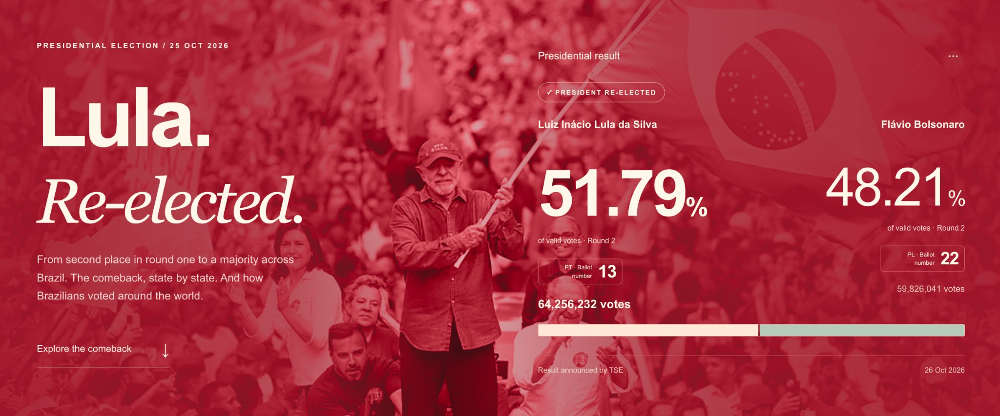

# Brazil in Red

[← All selected work](../README.md#selected-work)

**Turning curiosity into a story people can explore**

A national result tells you who won. I wanted to understand what sat beneath it: the differences between places, the change between rounds, and the experience of Brazilians voting abroad. I turned those questions into Brazil in Red, a bilingual interactive atlas.

## Finding the story beneath the result

The starting point was personal curiosity. As I explored the results, the question grew: how could I bring the national picture, regional differences, and overseas vote into one experience that made sense to someone arriving without all that context?

I chose to give the atlas an editorial direction, then let readers investigate it. The page moves from the national result to changes between rounds, Brazilian states, and voters abroad. That sequence gives people a way into the subject before asking them to navigate a map or interpret a table.

### A way into the subject

National result → Changes between rounds → Brazilian states → Voters abroad

## A guided story, with room to explore

I set the questions, directed the research and AI-assisted build, and shaped the structure, visual direction, and interaction design. The published experience covers 27 Brazilian federal units and 31 selected overseas countries and territories, with English and Portuguese views.

I wanted the narrative and the interactive elements to work together. A reader can follow the page for the main patterns, then use the maps, round selectors, regional filters, and comparison tables to examine a place that matters to them. Headings, labels, and visual hierarchy had to support both ways of reading.

### Inside the atlas

Project coverage: 27 brazilian federal units · 31 selected overseas locations · 2 language views.

Start with the national picture, then explore places and comparisons.

[Explore the project](https://brasil-voto-atlas-2026.shaunaleebrennan.chatgpt.site/)

## The choices behind the comparisons

The most useful iterations came from questioning what a reader could reasonably conclude from each visual. I pushed for changes wherever an apparently simple comparison could imply something the data did not establish:

- Give each percentage a clear meaning. A candidate’s share, the winner’s share, and a change between rounds answer different questions. The labels needed to identify the candidate, round, and voting basis.
- Make the rounds comparable. Round one includes other candidates. The atlas distinguishes all-valid-vote shares from a comparison recalculated around the two finalists, and separates a change in winner from the size of the swing.
- Choose the right level of context. Highlighting Ireland and France did not tell the whole European story. I asked for a regional view alongside the individual examples, so the selection of places would not carry more weight than it should.
- Keep interpretation within the evidence. Aggregate changes show how results differed between rounds; they do not establish how individual people switched their votes. Source links and methodology notes give readers a way to examine those boundaries.

## Making space for the people behind the numbers

I also wanted the atlas to convey what participation involved. I asked to include stories of people travelling by boat, offering lifts, and helping others reach the polls alongside the political context and disputes. That widened the story from the outcome of voting to the effort people made to take part.

The resulting project brings research, editorial judgment, and product design into one public experience. It reflects an approach I bring to product marketing: find the question people care about, turn complexity into a clear story, and make it easy to go deeper.

> A chart can be accurate and still tell the wrong story. Choosing what to compare is part of the strategy.

## Supporting evidence

- **[Explore Brazil in Red](https://brasil-voto-atlas-2026.shaunaleebrennan.chatgpt.site/)** — Live personal project. Explore the bilingual atlas, interactive maps, comparison tables, and sources and method section.
