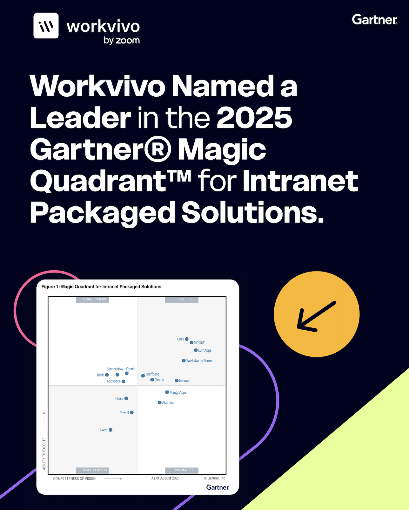
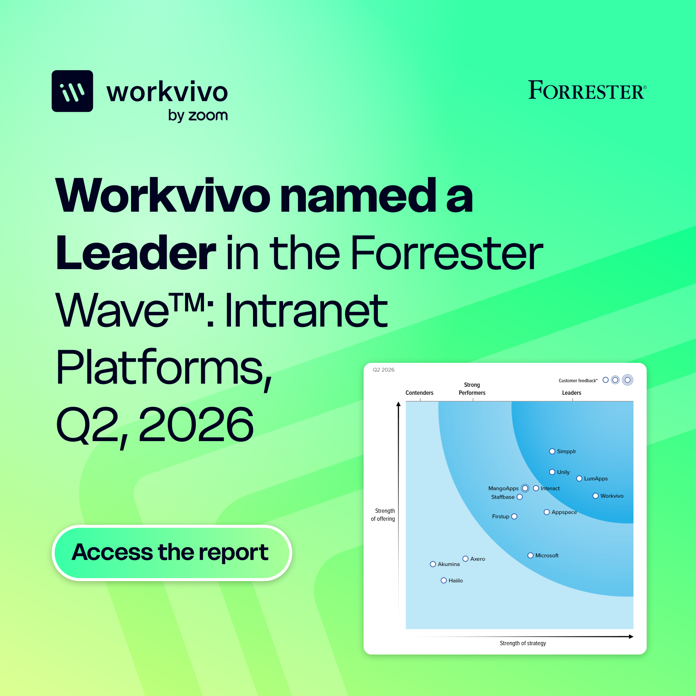

# Analyst Relations & Category Leadership

[← All selected work](../README.md#selected-work)

**Turning analyst relations into a strategic market leadership programme**

When Workvivo's dedicated analyst relations owner left, I took on the remit alongside leading Product Marketing. I built a repeatable programme that strengthened our existing position and helped open up adjacent markets.

## Beyond report deadlines

We had an established presence in employee experience and intranet research, but analyst engagement needed to become more than a series of report deadlines. We needed stronger relationships, a clear evidence base and a view of where the broader product portfolio could credibly compete.

**The programme ambition:** Build relationships and market intelligence that help Workvivo strengthen its position and assess adjacent categories.

## Building the analyst relations programme

I took ownership of analyst strategy, executive briefings, research submissions, customer proof and ongoing engagement across Gartner, Forrester, ClearBox and other firms. I connected the analyst programme with portfolio positioning, competitive intelligence and GTM, and expanded activity through strategy days, events and research conversations. I also used analyst and market signals to advise leadership on category shifts, product opportunities and where Workvivo should place its next bets.

### An ongoing intelligence cycle

Analyst relationships → Briefings + research → Market signals → Portfolio + GTM decisions

Strategy days, customer proof, submissions, and ongoing engagement connect the programme.

## Recognition and new category opportunities

The programme supported stronger year-on-year recognition, including Workvivo's fourth consecutive Gartner Magic Quadrant Leader placement in 2026, its 2026 Forrester Wave Leader position in Intranet Platforms and ClearBox Choice recognition.

### Published recognition campaigns

Gartner · 2025 campaign artwork

Forrester · 2026 campaign artwork

## Customer reviews, new categories

Customer reviews tell the same story from the other side. In G2’s Fall 2026 reports, Workvivo is a Leader in 10 Grids, ranked first of 25 in Enterprise Social Networking, and appears for the first time in Knowledge Base, Enterprise Search and Knowledge Management.

The AI portfolio is now visible there too: Workvivo is a High Performer in two new categories, AI Agents and Agentic AI, and is newly listed in AI categories including AI Agents for HR. As with every result here, these are company outcomes; G2 rankings come from customer reviews.

### G2 · Fall 2026

G2 Fall 2026 Grid reports. Rankings are G2’s, based on customer reviews; company recognition, not individual outcomes.

## Opening the next categories

With the core categories established, the programme is extending into adjacent ones. Workvivo is a new entry in the Forrester Wave for Employee Experience Management Platforms, with results due in November 2026, and has been invited to the Forrester Landscape report for Cognitive Search platforms, with the RFI submitted in November 2026. Both are in progress; an invitation is not a placement.

Coverage is broadening beyond evaluations too. ClearBox's new insights site includes a dedicated Workvivo report and a separate report on Seer by Workvivo, and at Zoomtopia's media and analyst event in London we presented a short Workvivo briefing alongside Zoom.

### In motion · November 2026

1. **Forrester Wave: Employee Experience Management** — A new entry for Workvivo. Results are due in November 2026.
2. **Forrester Landscape: Cognitive Search** — Invited to the Landscape report for cognitive search platforms. RFI submitted.
3. **ClearBox insights** — A dedicated Workvivo report, and a separate report on Seer by Workvivo.
4. **Zoomtopia, London** — A short Workvivo briefing alongside Zoom at the media and analyst event.

Evaluations in progress are invitations, not placements or outcomes.

[Explore ClearBox insights](https://insights.clearbox.co.uk/)

> If analyst relations only starts when a report is due, someone else’s calendar is setting your strategic agenda.

## Supporting evidence

- **[Gartner 2025 campaign artwork](../assets/evidence/gartner-mq-2025.png)** — Published campaign artifact. Company campaign creative, not the analyst report or proof of sole authorship.
- **[Forrester 2026 campaign artwork](../assets/evidence/forrester-wave-2026.png)** — Published campaign artifact. Shows the recognition campaign; analysts controlled their own assessment.
- **[Read the artifact inventory](../docs/EVIDENCE_INVENTORY.md)** — Evidence record. Sources and attribution boundaries for the analyst and category work.
- **[ClearBox insights](https://insights.clearbox.co.uk/)** — Analyst coverage. Includes a dedicated Workvivo report and a separate report on Seer by Workvivo.
