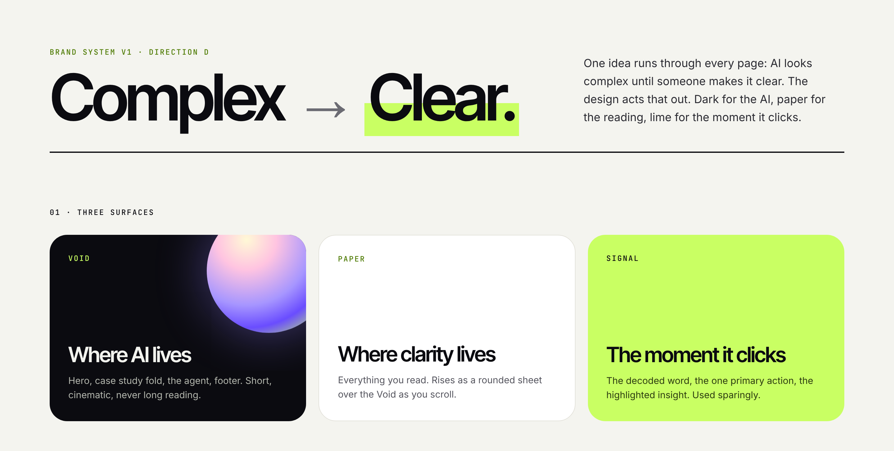
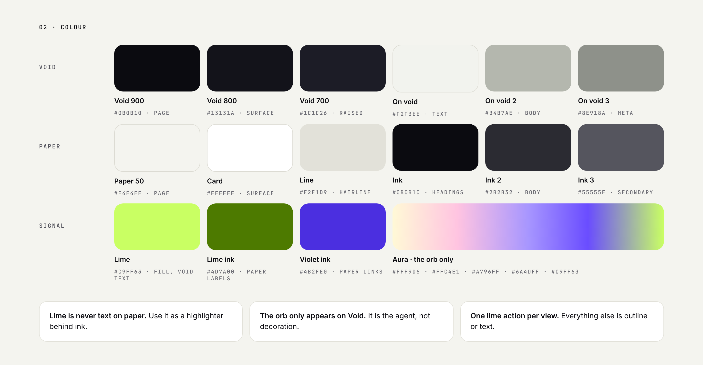
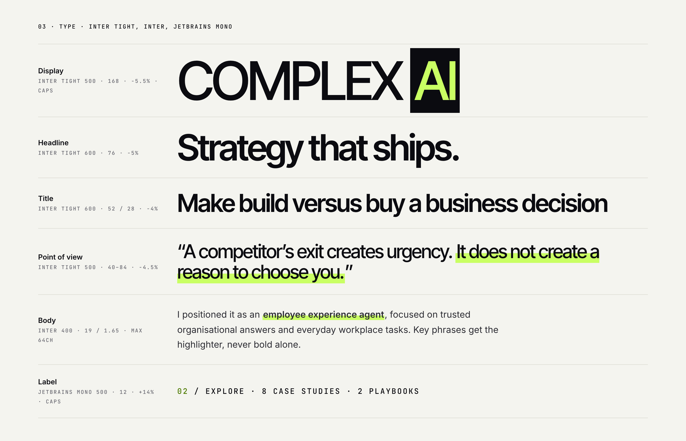
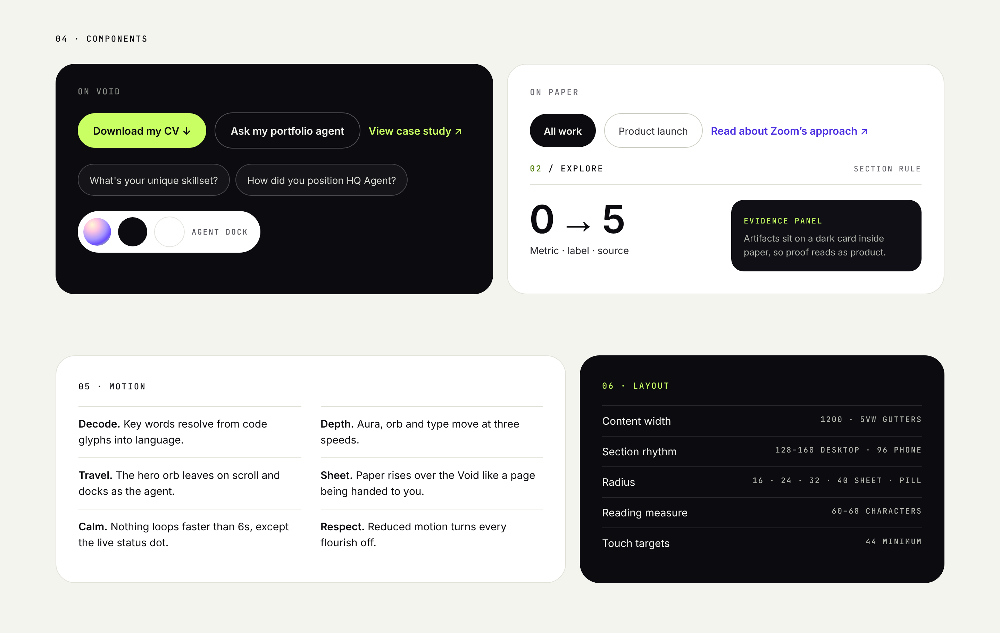

# Complex → Clear

The design system behind [Shauna Azevedo-Brennan's portfolio](https://shaunaleebrennan.github.io/shauna-ai-portfolio/).

One idea runs through every page: AI looks complex until someone makes it clear. The design acts that out. Dark for the AI, paper for the reading, lime for the moment it clicks.



| File | What it is |
| --- | --- |
| [`tokens.css`](tokens.css) | Every colour, type, layout, shape and motion value as CSS custom properties (`--cc-*`) |
| [`tokens.json`](tokens.json) | The same tokens as JSON, generated from `tokens.css` |

---

## 01 · Three surfaces

| Surface | Where | Holds |
| --- | --- | --- |
| **Void** | Where AI lives | The hero, every page's opening fold, the agent, Explore and the footer. Short and cinematic, never long reading. |
| **Paper** | Where clarity lives | Everything you read. It rises as a rounded sheet over the Void as you scroll. |
| **Signal** | The moment it clicks | Lime: the decoded word, the one primary action, the highlighted insight. Used sparingly. |

Every page outside the homepage follows the same order: a **Void fold** (label, title, lead, one primary action, cover), a **Paper sheet** for the reading, then a **Void close** with the agent prompts and the next story. Pages you browse rather than read (the library and the playbook collection) stay on the Void.

---

## 02 · Colour



| Token | Hex | Role |
| --- | --- | --- |
| `--cc-void` | `#0B0B10` | Void 900 · page |
| `--cc-void-2` | `#13131A` | Void 800 · surface |
| `--cc-void-3` | `#1C1C26` | Void 700 · raised |
| `--cc-text` | `#F2F3EE` | On void · text (17.6 : 1) |
| `--cc-text-2` | `#B4B7AE` | On void 2 · body (9.7 : 1) |
| `--cc-text-3` | `#8E918A` | On void 3 · meta (6.1 : 1) |
| `--cc-paper` | `#F4F4EF` | Paper 50 · page |
| `--cc-card` | `#FFFFFF` | Card · surface |
| `--cc-line` | `#E2E1D9` | Line · hairline |
| `--cc-ink` | `#0B0B10` | Ink · headings (17.8 : 1) |
| `--cc-ink-2` | `#2B2B32` | Ink 2 · body (12.7 : 1) |
| `--cc-muted` | `#55555E` | Ink 3 · secondary (6.7 : 1) |
| `--cc-lime` | `#C9FF63` | Lime · fill, text on Void |
| `--cc-lime-ink` | `#4D7A00` | Lime ink · labels on paper (4.6 : 1) |
| `--cc-violet-ink` | `#4B2FE0` | Violet ink · links on paper (6.8 : 1) |
| `--cc-aura` | `#FFF9D6 · #FFC4E1 · #A796FF · #6A4DFF · #C9FF63` | Aura · the orb |

Contrast ratios are against the surface the colour is used on.

**The three rules**

1. **Lime is never text on paper.** Use it as a highlighter behind ink (`--cc-highlight`).
2. **The orb only appears on the Void.** It is the agent, not decoration.
3. **One lime action per view.** Everything else is an outline or text.

---

## 03 · Type



| Role | Face | Spec |
| --- | --- | --- |
| Display | Inter Tight 500 | 168px · −5.5% · caps |
| Headline | Inter Tight 600 | 76px · −5% |
| Title | Inter Tight 600 | 52 / 28px · −4% |
| Point of view | Inter Tight 500 | 40–84px · −4.5%, key phrase highlighted |
| Body | Inter 400 | 19px / 1.65 · max 64 characters. Key phrases get the highlighter, never bold alone. |
| Label | JetBrains Mono 500 | 12px · +14% · caps |

All three families are self-hosted under the SIL Open Font License (licences in [`assets/fonts`](../assets/fonts)).

---

## 04 · Components, 05 · Motion, 06 · Layout



**Components**

| On the Void | On paper |
| --- | --- |
| One lime pill for the primary action (*Download my CV*), outline pills for the rest, lime text links | Ink pill for the current filter, outline pills for the others, violet links |
| Prompt chips that hand a question to the portfolio agent | Mono section rule: `02 / EXPLORE` |
| The agent dock: orb, void and paper states | Metrics as *value · label · source* |
| | Evidence panels: artifacts sit on a dark card inside paper, so proof reads as product |

**The orb** is glass, not a flat gradient: a bright white rim, a cream highlight top left, a blue band through the middle, lime pooling on the bottom-right edge and a thin iridescent ring (pink → lilac → lime). It is pure CSS: `.gorb` for the sphere and `.gorb-ring` for the ring, in `redesign.css`. Set `--gs` to scale the light with the orb's size (1 ≈ 280px, 1.5 for the hero, 0.2 for the dock).

**The orb has moods, and it is the agent.** It always stays the brand orb; what changes is its light. Set `data-orb-state` on the orb or its wrapper: no value is rest (an occasional glint), `listening` adds slow sheen sweeps and a lime glow, `thinking` and `connecting` shimmer quickly through deeper violet with a spinning ring, `speaking` goes acid (lime blooms through the glass with a lime halo) and swells. Every mood is drawn from the Aura scale above; nothing leaves it. The colours are registered custom properties (`--o1`…`--o6`, `--ob1/2`, `--og1/2`, sheen position `--sx`), so they glide. `agent.js` sets the state from the conversation (typing a question counts as listening; a typed answer "speaks" for about as long as it takes to read) and mirrors it on every orb that belongs to that conversation: the page orb, the ask box orb, the dock orb, the panel's avatar and the call orb. `--vol` (0–1) swells the orb with the loudness of the voice: live from the SDK in voice conversations, and from a measured loudness curve per clip in the tour (`LOUDNESS` in `tour.js`). In the hero, the orb and its tag (`.orbtag`, a real button on the orb's rim that fills lime on hover) open the conversation card, where the visitor picks a suggested question, types, or switches to a call; the tag also shows what the agent is doing.

**Motion**

- **Decode.** Key words resolve from code glyphs into language.
- **Depth.** Aura, orb and type move at three speeds.
- **Travel.** The hero orb leaves on scroll and docks as the agent.
- **Sheet.** Paper rises over the Void like a page being handed to you.
- **Calm.** Nothing loops faster than 6s, except the live status dot.
- **Respect.** Reduced motion turns every flourish off.

**Layout**

| | |
| --- | --- |
| Content width | 1200 · 5vw gutters |
| Section rhythm | 128–160 desktop · 96 phone |
| Radius | 16 · 24 · 32 · 40 sheet · pill |
| Reading measure | 60–68 characters |
| Touch targets | 44 minimum |

---

## Using the tokens

```html
<link rel="stylesheet" href="design-system/tokens.css">
```

```css
.cta {
  min-height: var(--cc-touch);
  padding: 0 24px;
  border-radius: var(--cc-radius-pill);
  background: var(--cc-lime);
  color: var(--cc-void);
  font: 600 15px var(--cc-font-body);
}
.key-phrase { background: var(--cc-highlight); }
```

Where it is applied on the site: [`redesign.css`](../redesign.css) (homepage), [`case-study-redesign.css`](../case-study-redesign.css) (case studies), [`brand-pages.css`](../brand-pages.css) (playbooks, library, documents and the IT Pressure Test), [`site-header.css`](../site-header.css) (shared header) and [`fonts.css`](../fonts.css).
