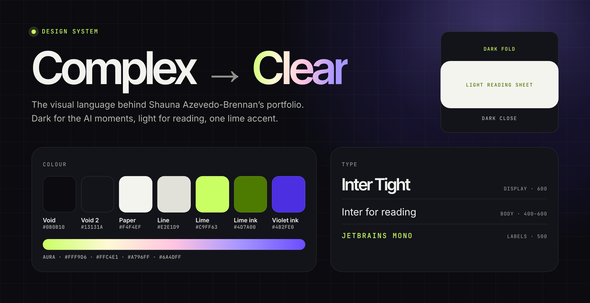

# Complex → Clear



The design system behind [Shauna Azevedo-Brennan's portfolio](https://shaunaleebrennan.github.io/shauna-ai-portfolio/). Its job is the same as the work it presents: make complex AI clear.

**Files in this folder**

| File | What it is |
| --- | --- |
| [`tokens.css`](tokens.css) | Every colour, type, layout, shape and motion value as CSS custom properties (`--cc-*`) |
| [`tokens.json`](tokens.json) | The same tokens as JSON, generated from `tokens.css` |
| `complex-to-clear.png` | The specimen above |

---

## Principles

1. **Dark for the AI moments, light for reading.** The void carries the hero, the work you browse, the agent and the close. Anything you read for more than a minute sits on a light paper sheet.
2. **One accent.** Lime means *act* or *live*: the primary button, the live dot, the current item. Everything else is neutral.
3. **Tight display, calm body, mono labels.** Headlines are big and tightly tracked. Reading copy is plain and roomy. Labels are small uppercase mono, so structure never competes with the story.
4. **Show the reasoning.** Numbers, steps and labels make the logic visible. Company results are labelled as company context, and personal contribution is professional self-report unless a source confirms it.

---

## Colour

### On the void (dark)

| Token | Hex | Use | Contrast on void |
| --- | --- | --- | --- |
| `--cc-void` | `#0B0B10` | Page background | — |
| `--cc-void-2` | `#13131A` | Cards and panels | — |
| `--cc-void-line` | `rgba(255,255,255,.10)` | Rules and card borders | — |
| `--cc-text` | `#F2F3EE` | Headlines and primary text | 17.6 : 1 |
| `--cc-text-2` | `#B4B7AE` | Secondary text | 9.7 : 1 |
| `--cc-text-3` | `#8E918A` | Meta and captions | 6.1 : 1 |
| `--cc-lime` | `#C9FF63` | Primary buttons, labels, live states | 16.8 : 1 |

### On paper (the reading sheet)

| Token | Hex | Use | Contrast on paper |
| --- | --- | --- | --- |
| `--cc-paper` | `#F4F4EF` | Sheet background | — |
| `--cc-card` | `#FFFFFF` | Cards and panels | — |
| `--cc-line` | `#E2E1D9` | Rules and borders | — |
| `--cc-ink` | `#0B0B10` | Headlines | 17.8 : 1 |
| `--cc-ink-2` | `#2B2B32` | Body copy | 12.7 : 1 |
| `--cc-muted` | `#55555E` | Secondary text | 6.7 : 1 |
| `--cc-muted-2` | `#6B6B73` | Meta | 4.8 : 1 |
| `--cc-lime-ink` | `#4D7A00` | Lime for text: labels, numbers, markers | 4.6 : 1 |
| `--cc-violet-ink` | `#4B2FE0` | Links in reading copy | 6.8 : 1 |

Lime is never used as text on paper; use lime ink instead. Dark text on a lime button is 16.8 : 1.

### Aura

The orb, the glows and the gradient word come from one family.

| Token | Hex |
| --- | --- |
| `--cc-cream` | `#FFF9D6` |
| `--cc-pink` | `#FFC4E1` |
| `--cc-lilac` | `#A796FF` |
| `--cc-violet` | `#6A4DFF` |

- **Gradient word** (`--cc-aura`): one word or line per screen, on dark only. The "AI" in the homepage headline and the second line of each page title. It drifts slowly and stops for reduced motion.
- **Glow** (`--cc-glow`): a soft violet radial behind every dark fold, top right.
- **Reading progress** (`--cc-progress`): a 3px lilac → pink → lime bar at the top of long pages.

---

## Type

All three families are self-hosted (SIL Open Font License, licences in [`assets/fonts`](../assets/fonts)).

| Role | Family | Weight | Size | Tracking | Line height |
| --- | --- | --- | --- | --- | --- |
| Display (hero, fold titles) | Inter Tight | 600 | `clamp(48px, 6.4vw, 100px)` | −0.055em | 0.95–0.98 |
| Section title | Inter Tight | 600 | `clamp(40px, 5vw, 76px)` | −0.05em | 0.98 |
| Title inside the sheet | Inter Tight | 600 | `clamp(32px, 3.6vw, 54px)` | −0.045em | 1.02 |
| Card title | Inter Tight | 600 | 22–44px | −0.03 to −0.045em | 1 |
| Lead | Inter | 400 | 18px | 0 | 1.6–1.65 |
| Body | Inter | 400 | 16–18px | 0 | 1.55–1.7 |
| Label | JetBrains Mono | 500 | 11–12px, uppercase | 0.14em | 1.5 |

---

## Layout

- **Content width** 1200px, **header width** 1440px, **gutter** `clamp(20px, 5vw, 64px)`.
- **Header** 84px, on the void, with a hairline rule. Wordmark in Inter Tight (*Shauna* 700, *Azevedo-Brennan* 500), links in Inter 15px, LinkedIn as an outline pill.
- **Section rhythm** `clamp(88px, 10vw, 150px)` between major sections.

### The page skeleton

Every page outside the homepage follows the same three parts.

| Part | Surface | Holds |
| --- | --- | --- |
| **Fold** | Void with the glow | Mono label, display title with one gradient line, lead, primary action, cover image |
| **Sheet** | Paper, 40px radius (28px on small screens), lifted with a soft shadow | The reading: chapters, tools, evidence |
| **Close** | Void | "Ask my portfolio agent" prompts, the next story, then the footer |

Pages you browse rather than read (Explore, the library, the playbook collection) stay on the void.

---

## Shape

| Token | Value | Used for |
| --- | --- | --- |
| `--cc-radius-pill` | 999px | Buttons, chips, filters, badges |
| `--cc-radius-chip` | 16px | Thumbnails |
| `--cc-radius-card` | 24px | Cards and cover images |
| `--cc-radius-panel` | 28px | Feature panels and the next-story card |
| `--cc-radius-sheet` | 40px | The reading sheet |

---

## Components

| Component | Spec |
| --- | --- |
| **Primary button** | Lime pill, 48px tall, void text, Inter 600 15px. Lifts 2px on hover. |
| **Secondary button** | Outline pill: `rgba(255,255,255,.28)` on dark, `#CFCEC4` on paper. |
| **Label** | JetBrains Mono 12px uppercase, 0.14em. Lime on dark, lime ink on paper. A pulsing lime dot marks something live. |
| **Prompt chip** | 42px outline pill that hands a question to the portfolio agent. Lime border on hover. |
| **Dark card** | Void 2, 1px `rgba(255,255,255,.08)` border, 24px radius. On hover: lime border at 50% and a 4–6px lift. |
| **Cover image** | 24px radius, hairline ring, deep shadow and a violet halo when it sits on the void. |
| **Chapter navigation** | Sticky list on wide screens (mono number, lime marker for the current chapter). Scrollable chips on small screens. |
| **Point of view** | The sheet's one dark moment: a void tile with a gradient quote. |
| **Next story** | Dark card with a 4:5 cover, a title and a lime arrow button. |
| **Footer** | "I build with AI, but I market for *humans*." with *humans* in lime, then name, role and links. |

---

## Motion

| Pattern | Value |
| --- | --- |
| Reveal | Fade up from 48px, 1s, `cubic-bezier(.2,.7,.2,1)` |
| Card hover | 4–6px lift with a border change, 0.3s |
| Gradient word | Background drift, 7–9s, linear, looping |
| Live dot | Lime pulse, 2.4s |
| Homepage parallax | Orb, grid and copy shift with the pointer and with scroll, at different rates |

Everything decorative stops when `prefers-reduced-motion: reduce` is set.

---

## Accessibility

- Text pairs meet WCAG 2.1 AA (contrast ratios above). Small text never uses lime on paper.
- Focus is visible on every interactive element. On content pages it is a lime outline on the void and a violet outline on paper; work cards lift and gain a lime ring.
- Buttons, pills, filters and prompt chips are sized for touch (42–48px tall).
- Decorative glows, grids and orbs are `aria-hidden`.
- Scroll reveals have a no-JavaScript fallback, so content is never left hidden.

---

## Using the tokens

```html
<link rel="stylesheet" href="design-system/tokens.css">
```

```css
.cta {
  min-height: 48px;
  padding: 0 24px;
  border-radius: var(--cc-radius-pill);
  background: var(--cc-lime);
  color: var(--cc-void);
  font: 600 15px var(--cc-font-body);
}
```

Where it is applied on the site: [`redesign.css`](../redesign.css) (homepage), [`case-study-redesign.css`](../case-study-redesign.css) (case studies), [`brand-pages.css`](../brand-pages.css) (playbooks, library, documents and the IT Pressure Test), [`site-header.css`](../site-header.css) (shared header) and [`fonts.css`](../fonts.css).
